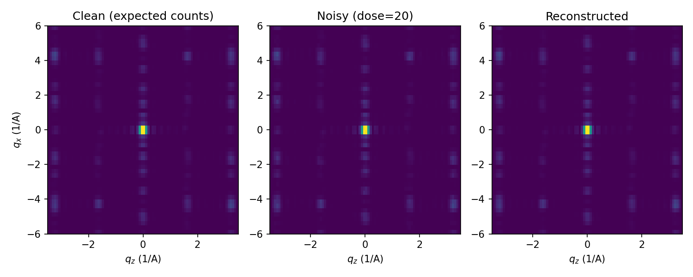
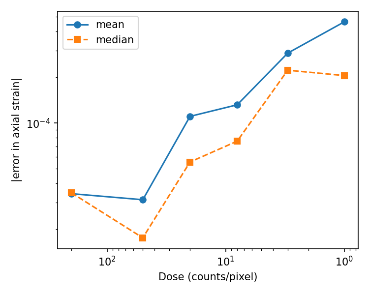

# Axial-Strain Reconstruction of a Biphenylene Nanotube from Noisy Diffraction Patterns

Applying a differentiable kinematic-diffraction workflow (PyTorch) to a DFT-relaxed, F-functionalised armchair biphenylene nanotube from my MSc thesis. This follows an earlier, simpler project with a 2-D crystal: [differentiable-diffraction-inverse](https://github.com/Zahra-code80/differentiable-diffraction-inverse).

## Method

- **Structure:** relaxed F-functionalised biphenylene nanotube (36 C, 1 F, 1 H) from a Quantum ESPRESSO `vc-relax` calculation (`F_tube.xyz`). The unit cell is 3.756 Å long along the tube axis ($z$).
- **Forward model:** the unit cell is repeated 6 times to form a short finite tube. A rigid axial strain $\varepsilon$ rescales all $z$ coordinates, $z \rightarrow (1+\varepsilon)\,z$. The kinematic intensity $|\sum_j f_j e^{i\mathbf{q}\cdot\mathbf{r}_j}|^2$ is evaluated on a 2-D slice ($q_x$, $q_z$) at $q_y = 0$. The scattering strength $f_j$ is approximated by the atomic number.
- **Noise and loss:** the true strain is $\varepsilon = 0.02$. Data are Poisson-noisy at a given dose (average counts per pixel). $\varepsilon$ is recovered by minimising the Poisson negative log-likelihood with Adam (autograd through the forward model).
- **Multi-start:** the loss has local minima. I start from 5 initial values ($\varepsilon_0$ from −0.03 to 0.05) and keep the solution with the lowest loss.

## Results



*Figure 1.* Example at dose = 20 counts/pixel: clean expected counts, one noisy realisation, and the pattern from the recovered strain ($\varepsilon = 0.01996$ vs. true 0.02).



*Figure 2.* Absolute error in the recovered axial strain versus dose (8 independent noise realisations per dose; mean and median shown).

| Dose (counts/pixel) | Mean abs. error in $\varepsilon$ | Median abs. error | Runs within 0.002 |
|---|---|---|---|
| 200 | 0.00003 | 0.00003 | 8/8 |
| 50 | 0.00003 | 0.00002 | 8/8 |
| 20 | 0.00011 | 0.00006 | 8/8 |
| 8 | 0.00013 | 0.00008 | 8/8 |
| 3 | 0.00029 | 0.00022 | 8/8 |
| 1 | 0.00046 | 0.00021 | 8/8 |

In the dose-20 example, 3 of the 5 starting values converged to the true strain, one ended near −0.014 (a local minimum), and one had not fully converged. Selecting the lowest-loss result gave the correct answer.

## Reproducing the figures

```
pip install -r requirements.txt
python nanotube_strain_reconstruction.py          # full run
python nanotube_strain_reconstruction.py --fast   # quick test
```

`F_tube.xyz` must be in the same folder as the script. The script prints the table above and writes `nanotube_patterns.png` and `nanotube_error_vs_dose.png`. Results vary slightly between runs because of the random noise.

## Limitations

- Data and reconstruction use the **same forward model**, so the errors reflect noise only, not model mismatch.
- The strain is a rigid rescaling of the relaxed geometry. The structure is **not re-relaxed**, so this is not a DFT strain calculation.
- Scattering strength is approximated by the atomic number, only a 2-D slice at $q_y = 0$ is used, and only one structure (F-functionalised) and one parameter are studied.
- 8 noise realisations per dose.

## Possible next steps

- Add the pristine and NH2-functionalised nanotube structures and ask at which dose they can be distinguished from their diffraction patterns.
- Use strained structures from fixed-cell DFT relaxations instead of a rigid rescaling.
