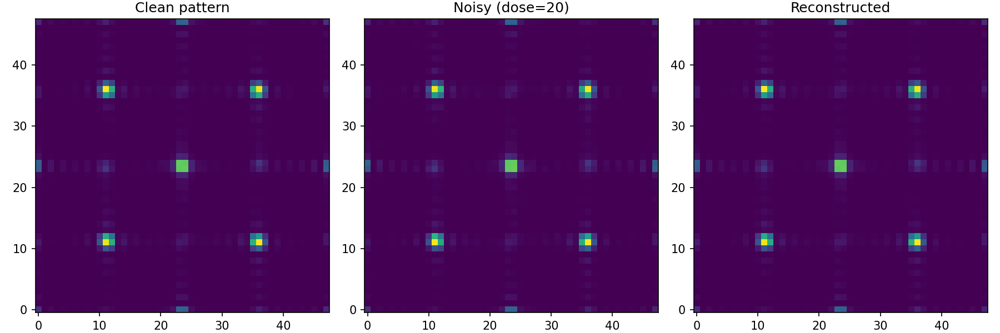
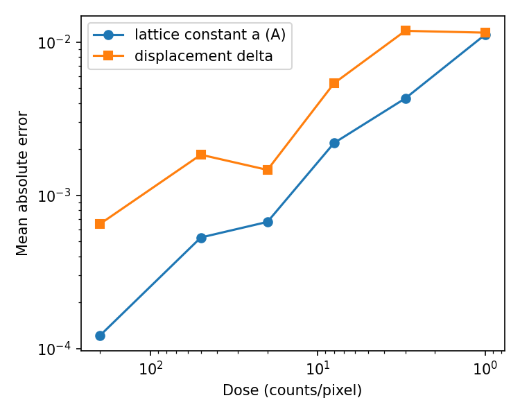

# Differentiable Kinematic Diffraction & Inverse Reconstruction

Recovering crystal structure parameters from noisy diffraction patterns by gradient descent through a differentiable physics model (PyTorch). This is a small learning project on the forward-model + inverse-problem workflow, not a realistic electron-scattering simulation.

## What this does

I simulate the kinematic diffraction pattern of a small 2-D crystal (6×6 unit cells, two atoms per cell) and recover two unknown structural parameters from a noisy measurement:

| Parameter | Symbol | True value | Meaning |
|---|---|---|---|
| Lattice constant | $a$ | 3.0 Å | Unit-cell size |
| Displacement | $\delta$ | 0.08 | Fractional offset of the second atom |

Noise is modelled as Poisson shot noise at different doses (average counts per pixel). The inverse problem minimises the mean-squared error between $\log(1+I_\mathrm{meas})$ and $\log(1+I_\mathrm{pred})$ with Adam. Gradients are obtained through the forward model with PyTorch autograd.

## Results



*Figure 1.* Example at dose = 20 counts/pixel. Left: noise-free pattern. Centre: noisy measurement. Right: pattern regenerated from the recovered parameters (single noise realisation: recovered $a = 2.9983$ Å, $\delta = 0.0860$).



*Figure 2.* Mean absolute error of the recovered parameters versus dose (mean over 8 independent noise realisations per dose, log-log axes, dose axis reversed so that noise increases to the right).

| Dose (counts/pixel) | Mean abs. error in $a$ (Å) | Mean abs. error in $\delta$ |
|---|---|---|
| 200 | 0.0001 | 0.0007 |
| 50 | 0.0005 | 0.0018 |
| 20 | 0.0007 | 0.0015 |
| 8 | 0.0022 | 0.0054 |
| 3 | 0.0043 | 0.0118 |
| 1 | 0.0112 | 0.0115 |

The lattice constant $a$ is recovered to better than 0.4% at every dose tested. The displacement $\delta$ is recovered to about 1–2% at doses of 20 or higher, but its error grows to roughly 15% of the true value (0.08) at doses of 3 and 1, where it stops getting worse. I have not investigated why (possible reasons: limited information in the data, or the optimiser not fully converging in 300 steps).

## Reproducing the figures

```
pip install -r requirements.txt
python make_figures.py
```

The script prints the table above and writes `patterns.png` and `error_vs_noise.png` in the current folder. Results vary slightly between runs because of the random noise.

## Limitations

- The forward model is purely kinematic (no multiple/dynamical scattering) and the crystal is a toy 2-D lattice. It does not model surface electron backscattering.
- Reconstruction starts from a guess close to the truth ($a_0 = 1.02\,a_\mathrm{true}$, $\delta_0 = 0$). I have not tested convergence from distant starting points, and the pattern has sharp peaks, so local minima are likely.
- Only two parameters are fitted, and the error values are means over only 8 noise realisations per dose.

## Possible next steps

- Poisson negative log-likelihood instead of the log-MSE loss.
- Apply the same workflow to atomic structures from my own DFT calculations (functionalised biphenylene nanotubes).
- Test robustness to the initial guess and to additional free parameters.
