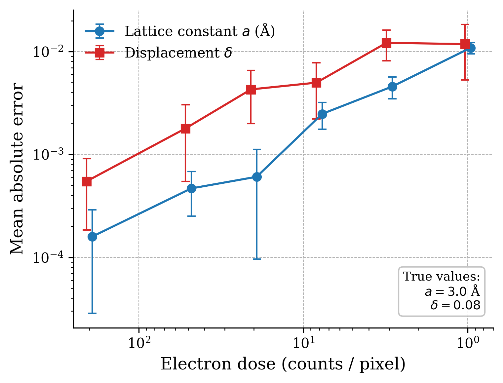
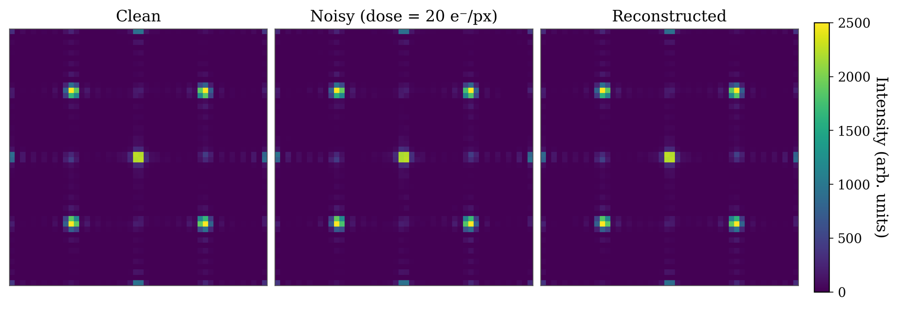

# Differentiable Kinematic Diffraction & Inverse Reconstruction

Recovering crystal structure parameters from noisy diffraction patterns by gradient descent through a differentiable physics model (PyTorch).

## What this does

We simulate the **kinematic diffraction** pattern of a small 2-D crystal (6×6 unit cells, two atoms per cell) and then recover the unknown structural parameters from a noisy measurement:

| Parameter | Symbol | True value | Meaning |
|-----------|--------|------------|---------|
| Lattice constant | \(a\) | 3.0 Å | Unit-cell size |
| Displacement | \(\delta\) | 0.08 | Fractional offset of the second atom |

Noise is modelled as Poisson shot noise at different electron doses. The inverse problem is solved by minimising the mean-squared error between \(\log(1+I_\text{meas})\) and \(\log(1+I_\text{pred})\) with Adam.

## Key result

Reconstruction error grows smoothly as the dose decreases, yet both parameters remain recoverable even at very low dose (~1 count/pixel).



*Figure 2.* Mean absolute reconstruction error versus electron dose (12 independent trials; error bars = 1 std). Axes are logarithmic; the dose axis is reversed so that lower dose (higher noise) appears on the right.



*Figure 1.* Example diffraction patterns at dose = 20 e⁻/px. Left: noise-free simulation. Centre: Poisson-noisy measurement. Right: pattern regenerated from the recovered parameters \((a,\delta)\).

## Reproducing the figures

```bash
python make_figures.py
```

Requires: `torch`, `numpy`, `matplotlib`.

The script writes both PNG (for GitHub / web) and PDF (for papers).

## Notes

- The forward model is purely kinematic (no dynamical scattering).
- Optimisation starts from a mildly perturbed initial guess (\(a_0 = 1.02\,a_\text{true}\), \(\delta_0 = 0\)).
- A more realistic loss (Poisson negative log-likelihood) or additional free parameters can be substituted with minimal code changes.
